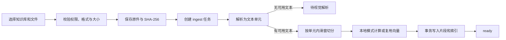

# 知源 RAG 模块需求、设计与接口

本文按 API v0.11.0 的当前工作区实现整理，以 `9d22950` 为提交基线，并纳入工作区中已有的文档版本检索调整。RAG 模块接收文档、提取文本、切分并建立索引，维护文档与索引版本，向搜索、自然问答和报告提供可追溯的检索结果。

## 1. 需求分析

### 1.1 职责边界

| 协作方 | 协作方职责 | 与 RAG 的交接 |
| --- | --- | --- |
| 知识库与权限 | 维护知识库状态、可见范围、团队成员及账号授权，校验调用权限 | 接口层根据权限确定可操作的知识库或文档，检索核心按已校验的知识库 ID 过滤候选 |
| 自然问答 | 根据问题和会话上下文组织查询，生成并核验答案，保存会话、消息和反馈 | 传入查询和已校验的知识库范围，接收排序后的证据片段和检索信息 |
| 报告 | 按章节组织查询，生成、审阅并发布报告 | 传入章节查询和已校验的知识库范围，接收可用于定位原文的证据片段 |
| 任务与配置 | 提供任务队列、状态查询、取消、重试和配置版本 | RAG 提交入库和重建任务，读取任务配置快照并写入处理进度 |

### 1.2 功能与验收

| 编号 | 需求 | 可观察的验收结果 |
| --- | --- | --- |
| RAG-01 | 接收文档、保留原件并跟踪入库进度 | 上传返回文档 ID 和任务 ID。可查看上传、解析、切分和索引的事件，按文档版本定位原件 |
| RAG-02 | 按文件类型提取文本，保留来源位置 | PDF 按物理页定位，Word 和 Markdown 按章节定位。整份文档无可索引文本时进入 `needs_extraction` |
| RAG-03 | 切分文本、生成所需向量并建立索引 | 片段带页码或章节、字符区间和哈希。片段与索引提交完成后才可被检索 |
| RAG-04 | 按指定知识库执行关键词、向量和混合检索 | 返回指定范围内排序后的片段及来源。无匹配时返回空结果 |
| RAG-05 | 维护索引和文档版本，支持失败恢复 | 可定位失败阶段并重试符合条件的任务。重新切分产生新版本，移除版本后新检索排除该版本，旧片段仍可按原 ID 追溯 |
| RAG-06 | 向自然问答和报告提供同一套检索能力 | 两个模块均可传入查询及知识库范围，取得片段原文、文档版本、位置和检索元数据 |

### 1.3 非功能要求与边界

- **范围一致性。** 召回、重排及邻接片段补充均使用调用方提供的知识库范围和可检索版本。空范围返回空结果。接口层在后台执行和耗时检索后使用共享权限校验。
- **可靠性。** 上传原文件时计算 SHA-256。入库任务保存配置快照和阶段历史。切片写入、文档正文更新与 PostgreSQL 搜索索引写入由同一事务提交，完成后文档变为 `ready`。
- **性能与可观测性。** 记录任务排队及阶段事件、检索 `elapsed_ms`、模型调用 `latency_ms`。入库应区分解析、切分、模型与写库耗时，检索质量可用带标注问题的来源或片段命中率验收。当前代码没有统一的延迟或召回率验收阈值。
- **处理边界。** 单文件上限为 100 MiB。扫描 PDF 的图像内容须先转为逐页图片，再走视觉解析入口。表格和幻灯片以文本提取为主。

## 2. 详细设计

### 2.1 组件和职责

| 层 | 组件 | 职责 |
| --- | --- | --- |
| 界面入口 | [DocumentsView](../frontend/src/views/DocumentsView.vue)、[SearchView](../frontend/src/views/SearchView.vue) | 上传原件、跟踪状态、发起检索 |
| 接口 | [main.py](../backend/app/main.py)、[admin_features.py](../backend/app/admin_features.py) | 接收文档及检索请求，调用共享权限检查，返回文档、原件、任务或检索结果 |
| 入库 | [ingestion.py](../backend/app/ingestion.py)、[jobs.py](../backend/app/jobs.py)、[worker.py](../backend/app/worker.py) | 持久化任务、运行处理阶段、保存尝试和失败历史 |
| 检索 | [rag.py](../backend/app/rag.py)、[retrieval_planner.py](../backend/app/retrieval_planner.py)、[search_index.py](../backend/app/search_index.py) | 查询规划、召回、融合、重排和证据输出 |
| 模型 | [local_models.py](../backend/app/local_models.py) | 本地向量计算与模型重排 |
| 存储 | [store.py](../backend/app/store.py)、[object_storage.py](../backend/app/object_storage.py) | 文档、片段、索引、处理事件和原件的持久化 |

### 2.2 文档入库



1. **接收与保存。** 上传为 multipart 表单。后端检查库状态、维护权限、扩展名和大小，分块读取并计算原件哈希。在同一知识库内，同名上传创建独立文档版本。原件可落到本地目录，或保存到 S3 兼容对象存储。API 返回 `201` 表示已接收，客户端通过处理状态接口确认最终结果。
2. **调度与状态。** `embedded` 模式在 API 进程内运行任务循环，`external` 模式由独立 worker 执行。上传后记录 `parse: queued`，随后依次进入 `parse`、`chunk`、`index`。解析与切分放在线程中执行。解析错误为 `parse_failed`，切分或索引出错可进入 `processing_failed`。任务重试沿用提交时的参数，新增尝试事件。
3. **按格式解析。** `parse_local()` 输出 `{page, section, text}` 单元。PDF 用 `pypdf` 按页提取文本层。DOCX 读取压缩包中的 XML 段落和标题样式。XLSX 用 `openpyxl` 只读遍历工作表行。PPT/PPTX 提取幻灯片文本。TXT、MD、CSV、HTML 先解码再分段，HTML 会去掉标签并解码实体。图片的普通解析返回空文本，可在有维护权时调用视觉接口。
4. **切分与定位。** `prepare_index()` 在每个单元内按字符切分。默认长度 800 字符，重叠 150 字符，步长 650。每片保存序号、页码、章节、文本、`char_start`、`char_end` 和片段 SHA-256。字符区间为文档结构化正文中的半开区间。页和段落之间保留单元边界。
5. **向量与写库。** 使用本地 BGE-M3 时，`cache_local_embeddings()` 在索引提交前批量计算缺失向量。缓存以模型命名空间与片段文本哈希为键。API 模式在语义检索时生成查询向量及未缓存的片段向量。TF-IDF 模式在检索时计算词项匹配。
6. **更新与追溯。** 重新切分和视觉解析会生成新文档版本。移除文档设置逻辑删除标记，保留原件和历史引用。当前工作区以同库同名的最新未移除 `ready` 版本参与新检索，因此正在处理或失败的新版本不会挡住上一可用版本。

支持的上传扩展名为 `.pdf`、`.docx`、`.txt`、`.md`、`.csv`、`.xlsx`、`.html`、`.ppt`、`.pptx`、`.png`、`.jpg`、`.jpeg`、`.webp`。

### 2.3 检索

1. **限定范围。** HTTP 搜索入口默认使用当前账号可读的启用知识库，并用 NFKC 与空白归并规范化查询。模块内调用由调用方传入已校验的知识库 ID。条件满足时可开启双语改写或子问题扩展，原始问题仍参与检索。改写失败时保留原始查询，并在管线信息中记录降级。
2. **生成候选。** 应用扫描在指定知识库的可检索版本上读取片段。PostgreSQL 模式在索引满足就绪条件时，用 GIN 全文检索和 pgvector HNSW 向量索引获取候选，随后进入同一应用层排序。索引不满足条件时走应用扫描。向量模式使用本地 BGE-M3、兼容 Embedding API 或 TF-IDF，关键词模式使用 BM25。
3. **融合与重排。** 混合模式用 RRF 融合两路排名，结合向量相似度、词项覆盖和显式主题约束筛选候选。重排可选轻量规则或 BGE Cross-Encoder，可在单次请求关闭。结果保留片段和文档 ID、来源、排序分数及命中查询。启用邻接上下文时可追加独立标记的片段，`total` 可能大于主结果的 `top_k`。
4. **交付检索结果。** 将排序后的原文片段及其来源元数据交给调用方。调用方用 `document_id` 和 `chunk_id` 找回命中的文档版本与片段，可用字符区间定位结构化正文。无匹配时交付空数组。

### 2.4 数据模型

| 表或存储 | 主键或关联 | 保存内容 |
| --- | --- | --- |
| `documents` | `id`，属于 `knowledge_base_id` | 原件位置与哈希、版本、结构化正文、处理状态、索引参数快照、逻辑删除标记 |
| `chunks` | `id`，`(document_id, ordinal)` 唯一 | 片段正文、页码、章节、字符区间和 SHA-256 |
| `embedding_cache` | `(namespace, sha256)` | 片段向量。本地命名空间区分模型、模型提交、池化方式和输入上限 |
| `chunk_search` | `chunk_id`，仅 PostgreSQL | 关键词词项、全文检索列、语言特征、可空的 1,024 维向量 |
| `jobs`、`job_events`、`document_events` | 通过任务或文档 ID 关联 | 任务快照、状态、尝试次数、时间、错误及进度事件 |
| `system_settings`、`model_calls` | 配置修订号，模型调用可关联任务 | 运行参数版本及调用耗时、状态与错误 |
| 本地目录或 S3/MinIO | 文档记录关联原件位置 | 原件字节与存储版本，数据库保存位置元数据 |

### 2.5 主要配置与性能因素

| 配置项 | 默认值或规则 | 性能影响 |
| --- | --- | --- |
| `chunk.size` / `chunk.overlap` | 800 / 150 字符，重叠须小于长度 | 片段数量影响索引体积、模型调用和检索工作量 |
| `embedding.provider` | `tfidf`。未保存运行配置时，如环境同时给出 API 地址与模型则使用 `api` | API 模式受网络和缓存影响，本地模式受模型加载、批大小和硬件影响 |
| `embedding.device` / `batch_size` / `max_length` | `auto` / 8 / 2048 Token | 本地模式自动选可用 CUDA，否则 CPU。批中最长序列影响填充和推理开销 |
| `retrieval.mode` / `top_k` | `hybrid` / 6 | 模式决定召回路线，主结果数影响证据上下文大小 |
| `retrieval.min_similarity` / `min_coverage` | 0.30 / 0.12 | 控制候选筛选，具体组合随检索模式和向量后端变化 |
| `retrieval.rerank` / `cross_language` | 开启 / 关闭 | 本地模型重排和查询改写可引入额外调用 |
| `queue.concurrency` / `max_attempts` | 2 / 3 | 控制后台并发和单任务尝试上限。本地 Embedding 和重排仍共用推理锁 |
| `answer_quality.enabled` / `answer_quality.context_neighbors` | 关闭 / 0 | 启用且邻接片段数大于 0 时，检索可附加同版本的相邻原文并单独标记 |

## 3. 接口定义

下列 HTTP 接口通过系统认证层接收 `Authorization: Bearer <token>`。除 multipart 上传和原件下载外，请求与响应使用 JSON。可运行服务的 `/docs` 和 `/openapi.json` 提供请求校验定义。

### 3.1 文档接收与处理

| 方法与路径 | 输入 | 成功响应 | 权限或约束 |
| --- | --- | --- | --- |
| `GET /api/documents` | 可选 `knowledge_base_id` | `200` 文档数组 | 有读取权限。省略库 ID 时列出可读启用库的未移除文档 |
| `POST /api/documents` | multipart 的 `knowledge_base_id`、`file`、可选 `modality=text\|image\|table` | `201` 文档记录，含 `id`、`version`、`status`、`job_id`、`has_original` | 目标库维护权限。等待 `ready` 再检索 |
| `GET /api/documents/{did}` | `compact=false`。紧凑模式支持 `offset=0`、`limit=40`（1–100）、`chunk_id` | `200`。标准模式含 `structured`、`chunks`、`versions`。紧凑模式含 `chunks`、`chunk_count`、`chunk_offset` | 文档读取权限。`chunk_id` 必须属于该版本 |
| `GET /api/documents/{did}/processing` | 路径 `did` | `200 {document_id,status,progress,stages,events,job,error}` | 文档读取权限。事件包含阶段、状态、尝试次数和时间 |
| `GET /api/documents/{did}/original` | 路径 `did`，可选 `Range` 请求头 | 原文件 `200`，范围请求可返回 `206` | 文档读取权限，缺少原件返回 `404` |
| `POST /api/documents/{did}/extract-vision` | 路径 `did` | `200` 新文档版本记录 | 文档维护权限、原图片可读、视觉模型可用 |
| `DELETE /api/documents/{did}` | 路径 `did` | `200 {ok,message}` | 文档维护权限，逻辑移除 |

### 3.2 HTTP 检索

| 方法与路径 | 输入 | 成功响应或行为 |
| --- | --- | --- |
| `POST /api/search` | `SearchBody` | `200 {mode,query,total,results,elapsed_ms,pipeline}` |

HTTP 搜索入口要求 `qa.use`，并校验目标知识库读取权限。省略知识库范围时，接口层使用当前用户可读的启用知识库。

**`SearchBody`**

| 字段 | 类型 | 规则 |
| --- | --- | --- |
| `query` | string | 必填，1–4,000 字符。规范化后为空返回 `422` |
| `knowledge_base_ids` | integer[] | 最多 30 项，服务端去重。非空时优先于单库字段 |
| `knowledge_base_id` | integer 或 null | 单库兼容字段 |
| `mode` | `vector\|keyword\|hybrid` 或 null | 省略时读取系统配置 |
| `top_k` | integer 或 null | 1–20，省略时读取系统配置 |
| `rerank` | boolean 或 null | 单次控制是否重排，省略时读取系统配置 |

请求示例

```json
{
  "query": "系统如何保存引用位置？",
  "knowledge_base_ids": [3],
  "mode": "hybrid",
  "top_k": 5,
  "rerank": true
}
```

`results[]` 的核心字段有 `document_id`、`chunk_id`、`knowledge_base_id`、`name`、`version`、`page`、`section`、`char_start`、`char_end`、`text`、`snippet`、`source`、`score`、`relevance`、`rerank_score`、`matched_queries`。定位引用时可用 `GET /api/documents/{did}?compact=true&chunk_id={chunk_id}`。无匹配时返回 `200` 和空数组。`pipeline` 随执行路径变化，可提供向量后端、重排方式、候选索引、改写与覆盖信息。排序分数用于结果排序，不能当作事实正确概率。

### 3.3 供自然问答和报告使用的检索接口

[rag.py](../backend/app/rag.py) 提供进程内异步函数，和 HTTP 搜索入口共用检索实现。

```python
async def retrieve(query, kb_ids, mode=None, top_k=None, rerank=None, expand_queries=True):
    ...

results, pipeline = await rag.retrieve(
    "系统如何保存引用位置？", [3], mode="hybrid", top_k=5
)
```

| 参数或返回值 | 契约 |
| --- | --- |
| `query` | 调用方组织好的搜索文本，可以是用户问题、结合上下文的追问或报告章节主题 |
| `kb_ids` | 由调用方完成权限和状态校验的知识库 ID 列表。空列表返回空结果 |
| `mode`、`top_k`、`rerank` | 可选检索参数。省略时使用当前运行配置或任务配置快照 |
| `expand_queries` | 默认允许检索规划器按配置执行查询扩展。传 `False` 时仅用原始查询 |
| `results` | 排序后的证据片段数组。片段字段与 HTTP 搜索一致，无匹配时为空数组 |
| `pipeline` | 本次执行的检索元数据，按实际走过的路径提供字段 |

自然问答在 [prepare_question()](../backend/app/main.py#L751) 中确定知识库范围，按需结合上一轮问题构造查询，再调用 `retrieve()`。报告在 [retrieve_section()](../backend/app/report_retrieval.py#L46) 中用章节标题、章节指令和模板提示构造查询。章节检索无结果时可加入报告上下文再查一次，返回证据及检索尝试记录。两者各自决定如何处理空结果和检索错误。

### 3.4 索引维护与任务

| 方法与路径 | 输入与约束 | 成功响应 |
| --- | --- | --- |
| `POST /api/tasks/reindex` | `{document_id}`，需文档维护权限 | `202 {job_id,status:"queued"}`，完成后 `result.document_id` 指向新版本 |
| `GET /api/tasks` | 可用 `kind=ingest` 或 `kind=reindex` 查看相关任务，也可按状态分页 | `200 {items,total,page,page_size}` |
| `GET /api/tasks/{jid}` | 本人授权任务或有运维读取权限 | `200` 任务状态、进度、尝试次数、结果和错误 |
| `GET /api/tasks/{jid}/events` | `after=0` 为事件 ID 游标，每次最多 500 条 | `200` 事件数组 |
| `POST /api/tasks/{jid}/cancel` | 排队或运行中任务，本人授权或运维管理权限 | `200 {ok:true}` |
| `POST /api/tasks/{jid}/retry` | 失败、中断或取消且尝试次数未用尽，复核原任务所有者当前权限 | `202 {job_id,status:"queued"}` |

任务查询、事件、取消和重试由共享任务服务提供。RAG 通过文档处理状态和任务结果交付入库或重建进度。

### 3.5 错误语义

| 状态码 | 常见场景 |
| --- | --- |
| `401` | 未登录、令牌过期或账号已停用 |
| `403` | 功能权限不足或知识库不在授权范围内 |
| `404` | 资源不存在、原件缺失或指定片段不属于该文档版本 |
| `409` | 知识库停用或归档、文档已移除或任务状态冲突 |
| `413` / `415` | 文件超限或扩展名不受支持 |
| `422` | 字段、文件名、分页、查询或视觉解析输入校验失败 |
| `502` / `503` | 上游服务响应失败，或必要模型未配置、不可用或推理失败 |

业务错误通常返回 `{"detail":"错误说明"}`，框架字段校验可返回 `detail` 数组。文件接收成功后，后台处理错误通过文档处理状态和任务结果返回。

## 4. 需求追踪

| 需求 | 代码入口 | 回归依据 |
| --- | --- | --- |
| RAG-01、RAG-02、RAG-03 | `upload()`、`ingestion.run()`、`parse_local()`、`prepare_index()` | [API 测试](../backend/tests/test_api.py)中的原件、格式与进度，[存储测试](../backend/tests/test_storage_upgrade.py) |
| RAG-04 | `retrieve()`、`search_index.candidates()` | [检索测试](../backend/tests/test_retrieval_v08.py)、[语义模型测试](../backend/tests/test_semantic_v09.py) |
| RAG-05 | `reindex_handler()`、`commit_index()`、`delete_document()` | [API 测试](../backend/tests/test_api.py)中的重试与版本追溯，[语义索引测试](../backend/tests/test_semantic_v09.py)中的失败版本保护 |
| RAG-06 | `retrieve()`、问答的 `prepare_question()`、报告的 `retrieve_section()` | [问答 API 测试](../backend/tests/test_api.py)中的证据和来源定位，[语义模型测试](../backend/tests/test_semantic_v09.py)中的章节检索 |
