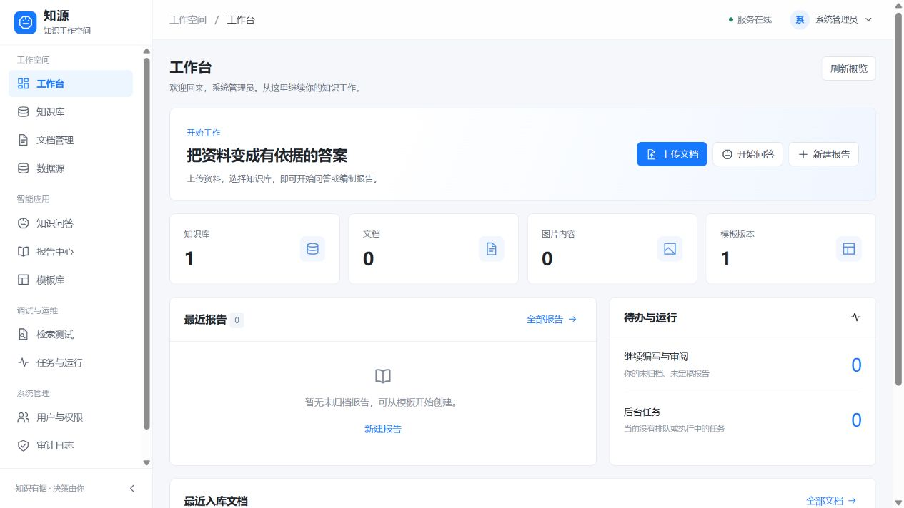

# 知源系统诊断与修复报告（2026-11-19）

> 本文保留首轮结果。后续已补真实 PostgreSQL、MinIO、模型、扫描 PDF 和音视频验收，最新状态见[遗留问题修复与实机验收](remaining-2026-11-19.md)。

## 结论

本轮已修复可复现的运行兼容、检索、问答权限、报告核验和 PostgreSQL 适配问题。当前活动实现的后端回归为 **218 passed、1 skipped、0 failed、0 errors**；前端 **6 项测试通过，生产构建通过**。隔离环境浏览器登录和 12 个主要页面检查通过，控制台未出现 error/warn。

该结果不代表真实模型效果、PostgreSQL/MinIO 部署、扫描 PDF OCR、音视频真实解码已经验收。现有知识库、数据库和密钥未改动；代码未提交或推送。

## 环境与范围

- 起始提交：`af599f611e0397f7895469523e1109cb222a12cd`。
- 本机项目虚拟环境实际为 Python 3.10.9，pytest 8.3.4；README 推荐 Python 3.12。
- 测试使用临时 SQLite、本地临时原件、模拟模型/对象存储；不调用付费模型。
- 发现虚拟环境缺少 `psycopg`、`boto3`，已按仓库 `requirements-server.txt` 补齐；`pip check` 通过。
- 本机初始 API、前端和 MinIO 均未运行，`.env` 未配置 PostgreSQL URL。浏览器检查另起临时空数据库与本机服务，检查后关闭，未启动业务数据库迁移。

## 已修复的问题

| 问题 | 原因及结果 |
| --- | --- |
| 查询改写、答案关键点补全在 Python 3.10 静默失效 | `asyncio.timeout` 仅在较新 Python 可用，其异常被降级路径捕获。改用 AnyIO 有界超时，并显式声明依赖；恢复改写与受核验的有限补全。 |
| 短英文资料未进入跨语言改写 | 英文检测要求至少 100 个字母，短事实资料被识别为无需改写。降低为 40 个字母，保留语言比例及证据门禁。 |
| 多问题问答只按整句召回 | 接口未接入已有 `split_question`，现对本轮明确分隔的问题启用本地拆分。 |
| 问答撤权后仍可能继续发起核验 | 将实时授权回调传入核验器，在调用前后复查；核验排队时允许有界预取下一批，保持核验并发上限及输出顺序。撤权时不发布核验或答案内容，后续核验不再调用。 |
| 报告仅引用变化被当成历史未核验 | 已有核验记录与正文或证据摘要不匹配时返回 `unverified_manual`，不再以 `legacy` 混淆已变化的记录。 |
| PostgreSQL 初始化/重复写入可能崩溃 | `ON CONFLICT DO NOTHING RETURNING id` 冲突时无返回行，原代码直接取 `['id']`。现正确返回 `lastrowid=None`。 |
| PostgreSQL 审计筛选 SQL 不兼容 | PG 分支使用 `strpos` 和 `timestamptz` 比较，SQLite 保留原有函数；保留参数化、时区归一和字面子串匹配。已验证 SQL 合同，真实 PG 集成待环境。 |

## 测试基建修正

- 角色矩阵生成唯一角色名；管理员用实际管理员身份测试，不再读取不存在的 `permissions` 字段。
- 原矩阵给 reviewer 配置了 `reports.generate`，却要求其读取公开库创建报告返回 403。修正为 201，另增无生成权限的 reader 场景断言 403；未更改产品授权规则。
- API 权限断言针对本用例知识库和文档，允许其他用例创建的公开库按设计可见。
- 正式报告导出断言标题与参考来源。普通正式文稿不强制含调试核验记录，核验记录仍在系统内保存。
- 报告候选通过活动编辑器接口 `/api/reports/{id}` 获取，增加任务完成和修改成功的显式断言。
- 补充旧任务重试返回 409 后章节完整状态保持不变的断言。
- 视频 OCR 失败用例原本替换了整个媒体处理器，且允许解析失败也通过。现运行真实媒体处理逻辑，仅模拟解码/ASR/OCR，断言两帧 OCR 都失败时转写仍成功入库。
- 关闭测试对本机 `.env` 的自动加载，明确隔离默认问答策略。
- `tests/*_V02.py` 是历史版本快照，包含重复客户端/生命周期和未接入当前应用的全文生成实现测试。通过 `conftest.py` 排除默认收集，文件保留。**首轮 272 项中有 55 项来自这些快照**，最终 219 项由原活动 217 项加 2 项新测试组成；通过数不可直接与首轮比较。没有用 `xfail` 遮蔽活动实现失败。

## 验证记录

| 检查 | 结果 | 证据 |
| --- | --- | --- |
| 原始全目录基线（含历史快照） | 241 passed / 30 failed / 1 skipped | [baseline.xml](../../test-results/diagnosis-2026-11-19/baseline.xml) |
| 最终活动实现完整回归 | 218 passed / 1 skipped，66.38 秒 | [final.xml](../../test-results/diagnosis-2026-11-19/final.xml) |
| 权限/API/问答专项 | 100 passed | [focused-security.xml](../../test-results/diagnosis-2026-11-19/focused-security.xml) |
| 报告模块独立运行 | 9 passed | [reports-standalone.xml](../../test-results/diagnosis-2026-11-19/reports-standalone.xml) |
| 前端现有测试 | 6 passed | `node --test tests/*.test.mjs` |
| 前端生产构建 | 成功，8.76 秒 | `node node_modules/vite/bin/vite.js build --configLoader runner` |
| 依赖一致性 | 通过 | `python -m pip check` |
| 改动空白检查 | 通过 | `git diff --check` |

最终唯一跳过项为真实 PG 审计过滤集成测试，需独立设置 `RAG_TEST_POSTGRES_URL`；该用例只使用会话临时表并回滚，不使用业务表。一个警告来自已有 Starlette/AnyIO 的弃用别名，不影响测试通过。

`pnpm build` 在当前受限环境尝试自动安装依赖并写入环境外目录而失败；使用项目已有 Vite 直接执行同一构建成功，未修改锁文件或依赖版本来规避检查。

浏览器检查覆盖：登录、工作台、知识库、文档管理、数据源、知识问答、报告中心、模板库、检索测试、任务与运行、用户与权限、审计日志、系统配置。这里的页面检查为加载、导航、空状态和配置缺失提示检查，不等同于真实模型生成链路验收。



## 尚待真实环境或后续功能验收

1. PostgreSQL + pgvector、MinIO、独立 worker 的联合实机验证尚未执行。
2. BGE、Kimi、ASR、视觉模型的真实质量、费用和延迟尚未复测；模拟用例通过不等于真实跨语言质量和复合问题覆盖达标。
3. 扫描 PDF 逐页 OCR 尚未实现，仍需逐页图片入口。
4. 重复上传的取消/覆盖/新版本交互尚未实现。
5. S3 Range 下载未进行完整对象哈希验证；未在本轮改变其流式性能语义。
6. 多事件循环查询改写缓存、真实 ffmpeg/LibreOffice、DOCX 在 Word 中的版式、并发压力与长时间运行仍需专项验收。
7. legacy 报告流式核验与 workflow 分批核验仍保留不同策略；本轮未做架构统一。

## 复现

```powershell
cd backend
.\.venv\Scripts\python.exe -m pytest tests -q -p no:cacheprovider --junitxml=../test-results/diagnosis-2026-11-19/final.xml
.\.venv\Scripts\python.exe -m pytest tests/test_reports_v06.py -q -p no:cacheprovider
.\.venv\Scripts\python.exe -m pip check
cd ../frontend
node --test tests/*.test.mjs
node node_modules/vite/bin/vite.js build --configLoader runner
```
