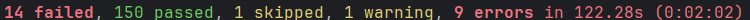

# 0.13.0 测试用例与数据集专项报告

- 被测版本：`0.13.0`
- 执行时间：`2026-11-16`
- 执行人：`张心蕊`
- 状态：**14 failed, 150 passed, 1 skipped, 1 warning, 9 errors**

## 一、结果截图


本机终端直接执行第二节命令后的实拍截图（未生成、未拼接）：



## 二、执行命令

```powershell
cd backend
.\.venv\Scripts\python.exe -m pytest tests -q -p no:cacheprovider --junitxml=..\docs\testing\v0.13-junit.xml
```

首次执行前：

```powershell
.\.venv\Scripts\python.exe -m pip install -r requirements-server.txt
```

## 三、执行记录

| 项目 | 值                                                                  |
| --- |--------------------------------------------------------------------|
| 执行时间 | `2026-11-16`                                                       |
| 执行人 | `张心蕊`                                                              |
| Python / pytest | 3.11.9 / 8.3.4                                                     |
| 结果 | `150 passed`，`14 failed`、`9 error`、`1 skipped`                     |
| 耗时 | `122.28 s`                                                         |
| 截图 | `v0.13-pytest-results-red.png`                                     |
| 机器可读结果 | `v0.13-junit.xml`：`tests=174`、`failures=14`、`errors=9`、`skipped=1` |

## 四、测试环境与隔离口径

| 项目 | 说明 |
| --- | --- |
| 操作系统 | Windows（本机开发环境） |
| 数据库 | 测试自带 `RAG_DATA_DIR` 临时目录与独立 SQLite，不触碰开发库 |
| 外部服务 | 模型、Embedding、ASR、视觉、HTTP 数据源全部 mock，**不发起计费调用** |
| 新增数据集 | `tests/data/multiformat-2026-11`、`tests/data/permissions.json`；不含项目运行数据或密钥 |

## 五、用例分布

| 测试模块 | 用例数 | 说明 |
| --- | --- | --- |
| `test_api` | 43 | 接口集成 |
| `test_quality_v010` | 38 | 引用与事实核验 |
| `test_semantic_v09` | 16 | 语义检索 |
| `test_workflow_v07` | 13 | 报告草稿/审阅/发布 |
| `test_retrieval_v08` | 11 | 中英召回与分章 |
| `test_report_modes` | 9 | 严格/综合模式 |
| `test_reports_v06` | 9 | 报告导出与校验 |
| `test_template_lifecycle` | 9 | 模板生命周期 |
| `test_media` / `test_html_text` / `test_data_sources` / `test_data_source_config` | 8/7/6/6 | 上轮新增 |
| `test_db_postgres_adapter` / `test_storage_upgrade` | 3/3 | 存储与适配 |
| **`test_multiformat_v013`** | **5** | **本轮新增**：加密 PPT、GB18030、JSON 展平、非法 JSON、帧 OCR 失败 |
| **`test_qa_grounding_extra`** | **3** | **本轮新增**：citations-only 篡改、judge 异常不补写、跨语言降级 |
| **`test_report_v013`** | **5** | **本轮新增**：定稿阻断/固定文字/正式导出/候选冲突/质量计数 |
| **`test_acl_matrix`** | **12** | **本轮新增**：权限矩阵参数化（以 `permissions.json` 为准） |
| **`test_pg_sqlite_parity`** | **4** | **本轮新增**：适配层翻译 3 例 + PG 已知不兼容 1 例（后者 PG 下运行） |
| 合计 | **<N>** | 以实际 JUnit 为准 |

> 说明：`test_pg_sqlite_parity` 前 3 例用假 `Inner` 测 `Connection` 翻译层，**在 SQLite 模式也会运行并通过**；第 4 例仅在 `RAG_DATABASE_URL` 存在时运行。因此第五行计数为"4 例，其中 3 例恒跑、1 例条件跑"，`<N>` 以 JUnit `tests` 属性为准。

## 六、本周新增与转绿明细

| 能力 | 用例 | 断言要点 |
| --- | --- | --- |
| 加密 PPT | `test_multiformat_v013.py::test_encrypted_ppt_is_rejected` | `parse_failed` 且错误可读（代码内构造 CFB 头，不读磁盘） |
| GB18030 | `test_multiformat_v013.py::test_gb18030_text_is_decoded` | 解码成功、片段含中文 |
| JSON 展平 | `test_multiformat_v013.py::test_json_is_flattened` | `a.b: 1`、`list[1]: x` |
| 非法 JSON | `test_multiformat_v013.py::test_invalid_json_reports_readable_error` | `parse_failed` + "JSON" |
| 帧 OCR 失败 | `test_multiformat_v013.py::test_video_frame_ocr_failure_keeps_transcript` | 不崩溃、状态可读（无 ffmpeg 时放宽为 `needs_extraction/parse_failed`） |
| 仅 citations 篡改 | `test_qa_grounding_extra.py::test_citations_only_tamper_marks_unverified` | 回 `unverified_manual` |
| judge 异常 | `test_qa_grounding_extra.py::test_judge_unavailable_does_not_trigger_repair` | `REFUSAL`、不补写 |
| 跨语言降级 | `test_qa_grounding_extra.py::test_cross_language_degraded_keeps_gates` | `degraded`、空结果 |
| 定稿阻断 | `test_report_v013.py::test_finalize_blocked_by_unreviewed_sections` | 409 + issues |
| 固定文字 | `test_report_v013.py::test_finalize_requires_fixed_text_review` | 422 |
| 正式导出 | `test_report_v013.py::test_final_export_requires_release` | 未定稿 409、定稿 200 |
| 候选冲突 | `test_report_v013.py::test_candidate_accept_conflict` | 正文变更后 accept 409 |
| 质量计数 | `test_report_v013.py::test_quality_counts_human_accepted` | reviewed/human_accepted |
| 权限矩阵 | `test_acl_matrix.py` 12 例 | 与 `permissions.json` 一致 |
| 适配层翻译 | `test_pg_sqlite_parity.py` 前 3 例 | `ON CONFLICT DO NOTHING` / `pg_advisory_xact_lock` / `RETURNING id` |
| PG 已知不兼容 | `test_pg_sqlite_parity.py::test_audit_export_postgres_incompatible` | `skipif` 非 PG；PG 下应 ≥500 |

## 七、前端构建与数据迁移验证

- 前端：沿用 `frontend/tests/profile-validation.test.mjs`（6 passed），本轮未新增前端自动化。
- 迁移：`test_storage_upgrade.py` 3 例通过；`db_postgres.py` 翻译层 3 例通过。

## 八、未覆盖与风险

| 项 | 说明 |
| --- | --- |
| 真实 ASR/视觉/ffmpeg | 自动化以 mock 替代；真实解码未纳入回归 |
| PostgreSQL + MinIO | 测试用隔离 SQLite 与本地存储 |
| 前端交互 | 无浏览器自动化 |
| 扫描 PDF 逐页 OCR | 仍提示逐页图片上传 |
| PG 审计导出 | `instr`/`julianday` 不兼容（见待处理） |
| 多 loop 查询改写缓存 | 单 loop 已覆盖；多 loop 未覆盖 |
| S3 Range 下载哈希校验 | `local_path` 校验、`original_response` Range 分支未校验 |

## 九、仍待处理的问题

见 `docs/open-issues.md`，共 **13 项**：

1. 扫描版 PDF 逐页 OCR（v0.12 遗留）
2. 审计导出 PG 兼容（v0.12 遗留）
3. 中文问英文资料召回不足（web-live P1）
4. 跨文档/分章检索不完整（web-live P1）
5. 重复上传无交互选择（web-live P1）
6. 重排抹平模式差异（web-live P2）
7. 导出与核验体验（web-live P2）
8. token 遥测缺失（web-live P2）
9. `test_api.generated_report`/`section_path` 可见性确认
10. legacy 与 workflow 两条核验路径语义不一致
11. 旧任务重试被拒后章节状态缺显式用例
12. `report_grounding.current` 仅 citations 篡改的独立断言
13. 多模态/边界合并项（加密 PPT、帧 OCR 全失败、多 loop 缓存、S3 Range 校验）

## 十、复现步骤

```powershell
cd backend
.\.venv\Scripts\python.exe -m pip install -r requirements-server.txt
.\.venv\Scripts\python.exe -m pytest tests -q -p no:cacheprovider
```