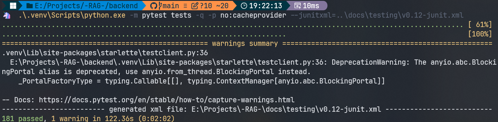

# 0.12.0 单元测试与回归报告

- 被测版本：`0.12.0`（语音/视频接入、HTML 结构化解析、图片 OCR 扩展、数据源导入）
- 执行时间：2026-11-15 19:22（Asia/Shanghai）
- 执行人：胡艺镭
- 状态：**已执行并通过**。截图为本机终端实拍，执行记录与机器可读结果在同一目录留存。

## 一、结果截图

本机终端直接执行第二节命令后的实拍截图（未生成、未拼接）：



## 二、执行命令

```powershell
cd backend
.\.venv\Scripts\python.exe -m pytest tests -q -p no:cacheprovider --junitxml=..\docs\testing\v0.12-junit.xml
```

- `-q`：只输出进度点与汇总，适合截屏。
- `--junitxml`：同时落一份机器可读结果，便于核对数量，不覆盖终端输出。
- 首次执行前需确认依赖齐全：`.\.venv\Scripts\python.exe -m pip install -r requirements-server.txt`（需要 `pypdfium2`、`boto3`、`psycopg`）。

## 三、执行记录

| 项目 | 值 |
| --- | --- |
| 执行时间 | 2026-11-15 19:22（Asia/Shanghai） |
| 执行人 | 胡艺镭 |
| Python / pytest | 3.11.9 / 8.3.4 |
| 结果 | `181 passed`，`0 failed`、`0 error`、`0 skipped` |
| 耗时 | 122.36 秒（0:02:02） |
| 截图 | `v0.12-pytest-results.png`（终端实拍） |
| 机器可读结果 | `v0.12-junit.xml`：`tests=181`、`failures=0`、`errors=0`、`skipped=0`、`time=122.344`、`timestamp=2026-11-15T19:22:20+08:00` |

## 四、测试环境与隔离口径

| 项目 | 说明 |
| --- | --- |
| 操作系统 | Windows（本机开发环境） |
| 数据库 | 测试自带 `RAG_DATA_DIR` 临时目录与独立 SQLite，不触碰开发库 |
| 外部服务 | 模型、Embedding、ASR、视觉与 HTTP 数据源全部用模拟或本地 HTTP 服务替代，**不发起计费调用** |
| 前端 | Node LTS + pnpm，Vite 6.4.5 |

## 五、用例分布

| 测试模块 | 用例数 | 说明 |
| --- | --- | --- |
| `test_api` | 43 | 接口集成：上传、处理状态、视觉解析、权限、配置 |
| `test_quality_v010` | 38 | 引用与事实核验质量门禁 |
| `test_semantic_v09` | 16 | 语义检索与向量缓存 |
| `test_workflow_v07` | 13 | 报告草稿、审阅与发布 |
| `test_retrieval_v08` | 11 | 中英召回与分章检索 |
| `test_report_modes` | 9 | 严格/综合两种报告生成模式 |
| `test_reports_v06` | 9 | 报告导出与校验 |
| `test_template_lifecycle` | 9 | 模板生命周期状态机 |
| **`test_media`** | **8** | **本周新增**：语音转写、视频抽音轨、缺 ffmpeg、超长拒绝、BMP→PNG、本地 OCR 缺依赖 |
| **`test_html_text`** | **7** | **本周新增**：脚本剥离、表格/列表/alt、GB18030、截断、JSON 展平 |
| **`test_data_source_config`** | **6** | **本周新增**：环境变量引用、重复 ID、路径穿越、后缀拒绝、越权 404 |
| **`test_data_sources`** | **6** | **本周转绿**：HTML 去脚本、旧版 Office、五类数据源导入、跨库 404、重定向 502、版本 v2.0 |
| `test_db_postgres_adapter` | 3 | SQLite→PostgreSQL 适配 |
| `test_storage_upgrade` | 3 | 存储与 worker 迁移 |
| 合计 | **181** | |

## 六、本周新增与转绿明细

| 能力 | 用例 | 断言要点 |
| --- | --- | --- |
| 语音接入 | `test_media.py::test_audio_upload_transcribes_into_timestamped_chunks` | WAV 上传后 `ready`，`modality=audio`，片段章节以 `00:00:00` 开头，`media_meta` 含时长与转写模型 |
| 未配置转写 | `test_media.py::test_audio_without_service_waits_for_explicit_transcription` | 停在 `needs_extraction`，`can_continue_transcription=true`，手动接口未配置时 503，配置后 202 并完成 |
| 视频接入 | `test_media.py::test_video_uses_extracted_audio` | 调用抽音轨函数，`modality=video`，`media_meta.audio_extracted=true`，至少两个片段 |
| 缺 ffmpeg | `test_media.py::test_video_without_ffmpeg_reports_actionable_error` | `parse_failed` 且错误信息含 `ffmpeg`，仍可继续转写 |
| 超长音视频 | `test_media.py::test_overlong_media_is_rejected` | 超过 `max_duration_seconds` 抛「上限」错误 |
| 图片 OCR | `test_media.py::test_bmp_image_is_normalized_to_png_before_ocr` | BMP 上传后需手动解析；送给视觉模型的 data URL 为 `image/png`；结果进入片段 |
| 本地 OCR | `test_media.py::test_local_ocr_provider_requires_optional_package` | 未安装 `rapidocr-onnxruntime` 时 503 且提示安装 |
| HTML 补齐 | `test_html_text.py` 7 项 | 脚本/样式不入索引、标题成章节、表格行按 ` | ` 拼接、列表与 alt、GB18030、200 万字符截断、JSON 展平 |
| 数据源 | `test_data_sources.py::test_import_configured_sources` | 五类来源（web/api/object/drive/database）导入后均可就绪；跨库 404、重定向 502、同名 `v2.0` |
| 旧版 Office | `test_data_sources.py::test_legacy_office_ingestion` | `.doc`/`.xls` 先转换再解析，`modality` 分别为 text/table |

补充说明：`test_data_sources.py` 是上游提交时就写好的规格测试。按代码静态核对，实现前其中 4 项必然红或报错（缺 `_convert_office`、无数据源路由、HTML 未剥离脚本）；当时本地 venv 缺少 `pypdfium2`，整套测试在收集阶段即报错，**没有留下实现前的实际红灯日志**，此处如实说明，不当作实测记录。

## 七、前端构建与数据迁移验证

- 前端生产构建：`pnpm build` 通过（Vite 6.4.5，约 9 秒）；新增 `DataSourcesView` 分包正常生成。
- 数据迁移：复制开发库副本后加载新版后端，`documents` 表自动补出 `media_meta`、`source_ref`；旧配置（无 `asr/ocr/media` 段）可正常加载并补默认值（`asr=disabled`、`ocr=vision`、`media.auto_transcribe=true`）。

## 八、未覆盖与风险

| 项 | 说明 |
| --- | --- |
| 真实语音/视觉/媒体调用 | 自动化测试以替换函数模拟，真实 ASR、视觉模型与 ffmpeg 解码未纳入回归 |
| PostgreSQL + MinIO | 测试使用隔离 SQLite 与本地存储，真实数据库迁移与对象存储未联调 |
| 前端交互 | 无前端自动化测试，数据源页、播放器与设置卡仅有构建校验 |

## 九、仍待处理的问题

1. **扫描版 PDF 逐页 OCR**：当前仍提示「转为逐页图片上传」，长文档需要逐页处理，是最可能影响验收体验的能力缺口。
2. **审计导出的 PostgreSQL 兼容性**：`instr`/`julianday` 在 PG 模式下不可用，正式部署调用审计导出会失败（上游遗留，见 `docs/design-review-module5-2026-11-11.md` 第二节）。

## 十、复现步骤

```powershell
cd backend
.\.venv\Scripts\python.exe -m pip install -r requirements-server.txt   # 首次需补 pypdfium2/boto3/psycopg
.\.venv\Scripts\python.exe -m pytest tests -q -p no:cacheprovider
```

前端：

```powershell
cd frontend
pnpm install
pnpm build
```
